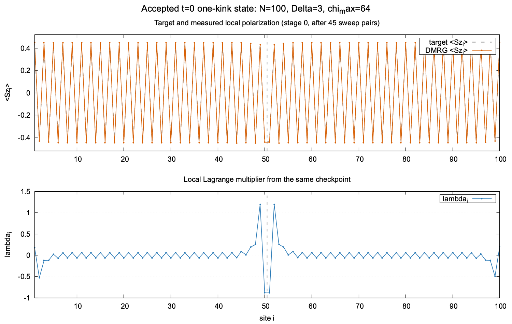

# One-kink constrained DMRG and AVP target evolution

This folder contains the original one-site, local-multiplier solver used in the N=100, Δ=3 one-kink experiment, plus a compact driver that runs the full loop. The `DMRGOpt/` source is bundled here from `Constrained_DMRG_trial/src` so the example does not require that separate checkout or a Rivanna path. It uses the repository's Julia project (`TensorOperations`).

Run from the repository root:

~~~bash
julia --startup-file=no --project=. -e 'using Pkg; Pkg.instantiate()'
julia --startup-file=no --threads=1 --project=. constrained_DMRG/one_kink_avp.jl
~~~

The default is N=100, Δ=3, bond cap χ=64, a single wall at bond 50|51, 250 target updates, and at most 100 complete right/left sweep pairs per target. The initial target has alternating polarization of magnitude 0.439364 on each side, with opposite Néel phase across the wall. Its sum is zero. The starting MPS is random with full bond capacity and a small bias toward that target; λ starts at twice the target.

## Update order

The convention is `H_eff = H_XXZ − sum_i λ_i S_i^z`. At every site visit, [the local solver](DMRGOpt/Algorithms/dmrg.jl) holds the left and right environments fixed, finds the lowest one-site effective-Hamiltonian vector with `LanczosSolver(3,1)`, measures its local z-polarization, and updates `λ_i += 0.005 × (target_i − measured_i)`. It repeats this local solve until the site residual is below 0.01 or 500 local iterations are used. Only then does QR/LQ move the orthogonality center to the next site. One full sweep pair goes right, then left.

After each pair, the driver measures all 100 local polarizations afresh. A target stage is accepted after two consecutive pairs satisfy both maximum local residual ≤ 0.01 and maximum λ change ≤ 0.01. The same MPS and λ warm-start the next stage. The target then evolves by

~~~text
target_i(t + dt) = target_i(t) − dt × gamma × [λ_i − mean(λ)]
dt = 0.05, gamma = 0.05
~~~

Subtracting the mean keeps the *target* sum at zero. The MPS implementation does not impose an exact U(1) total-Sz quantum-number block; check the measured total Sz in `sweeps.csv` if that matters for a modified run. The code deliberately continues from an approximate state if a stage reaches the sweep cap; `accepted=false` and a warning identify that case. Such later stages should not be interpreted as converged adiabatic states.

## Output

By default results go to `constrained_DMRG/output/N100_Delta3_one_kink/`:

- `sweeps.csv`: residuals, λ changes, failures, effective and bare XXZ energies, measured total Sz, and acceptance after every sweep pair.
- `profiles.csv`: target, measured local z-polarization, and λ for every site after every pair. This is enough to plot kink disappearance and multiplier evolution.
- `stages.csv`: one summary per target stage, including the two central polarizations.
- `stage_0000.jls`, etc.: serialized MPS tensors, target, λ, measured profile, and acceptance status at each stage.

The program refuses to overwrite a nonempty output directory. Set `AVP_OUTPUT` to a new path for another run. The main parameters can also be overridden through `AVP_N`, `AVP_CHI`, `AVP_STAGES`, `AVP_MAX_SWEEPS`, `AVP_LOCAL_TOL`, `AVP_GLOBAL_TOL`, `AVP_ALPHA`, `AVP_DT`, and `AVP_GAMMA`.

This is the unrestricted one-kink target flow: the DMRG solver has no frozen background or explicit defect constraint. It can relax from the localized kink branch toward another XXZ branch as λ changes. The sweep and profile files make that behavior inspectable.

## Reference t=0 kink profile and loadable checkpoint

The figure below is from the actual N=100, Δ=3, χ=64 run that accompanies this example. It shows the accepted stage-0 target and measured local polarization together with the λ field from that same checkpoint. Stage 0 was accepted after 45 complete right/left sweep pairs (max local residual `9.9994e-3`). This is the DMRG-relaxed t=0 state, not the raw biased random seed. The vertical line marks the central bond 50|51.

The matching files are bundled in [`reference/`](reference/):

- [`one_kink_t0_mps.jls`](reference/one_kink_t0_mps.jls): serialized checkpoint containing the MPS tensors, target profile, measured profile, λ vector, stage, and acceptance flag.
- [`one_kink_t0_profile.csv`](reference/one_kink_t0_profile.csv): one row per site with target, measured polarization, and λ.
- [`one_kink_t0_lambda.csv`](reference/one_kink_t0_lambda.csv): minimal site/λ table for direct reuse as a field.
- [`load_t0_checkpoint.jl`](reference/load_t0_checkpoint.jl): convenience loader for recovering the `MPS` object and checkpoint fields.
- [`plot_t0_profile.gp`](reference/plot_t0_profile.gp): reproduces the PNG from the CSV with gnuplot.

From the repository root, load the checkpoint in Julia with:

~~~julia
include("constrained_DMRG/reference/load_t0_checkpoint.jl")
data = load_t0_checkpoint()
psi = data.mps
lambda = data.lambda
target = data.target
measured = data.measured
~~~

The driver now also writes `t0_mps.jls`, `t0_profile.csv`, and `t0_lambda.csv` into each run's output directory immediately after stage 0. `t0_lambda.csv` is a minimal site/λ export for scripts that only need the field. To regenerate the reference image, run `gnuplot plot_t0_profile.gp` from `constrained_DMRG/reference/`. Check `accepted` in the checkpoint (and `stages.csv`) before treating an automatically generated t=0 state as converged.
