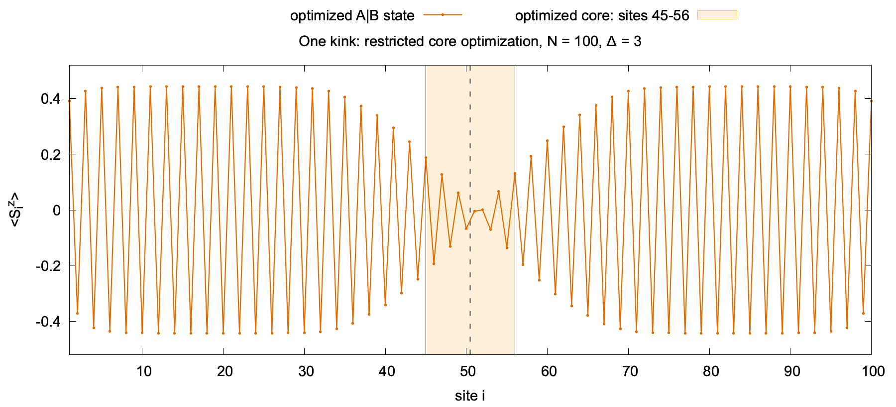
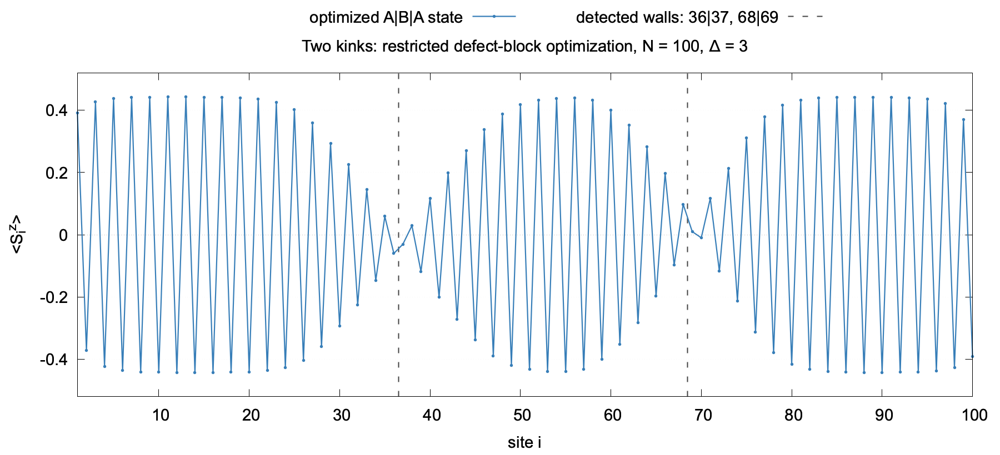

# Kinks in real space

These standalone Julia programs prepare localized variational kink states for the open, zero-field spin-½ XXZ chain with $N=100$ and $\Delta=3$. They are static state-preparation examples, not AVP dynamics. Run from the repository root:

~~~bash
julia --startup-file=no --project=. -e 'using Pkg; Pkg.instantiate()'
julia --startup-file=no --threads=1 --project=. kinks-in-real-space/one_kink.jl
julia --startup-file=no --threads=1 --project=. kinks-in-real-space/two_kinks.jl
~~~

Each file includes the tensor-network primitives it needs from the bundled `src/` directory, inherited from Nishan Ranabhat's [Quench_dyn](https://github.com/NishanRanabhat/Quench_dyn). Neither requires a prior checkpoint, another example script, or an external field. Python `matplotlib` is optional and used only for the PNG; Julia always saves CSV and the final MPS.

## Common preparation

1. Initialize an up-down Néel product MPS. Run zero-field two-site DMRG with bond cap $\chi=64$ to dress it into a symmetry-broken Néel background $A$. The product seed selects the branch; no field pins it.
2. Generate the opposite branch $B$ by swapping the up/down physical tensor slices on the selected segment. This changes the state, not the Hamiltonian.
3. Join segments into $A|B$ or $A|B|A$. Dressed virtual bonds remain available across each junction. The junction is a seed, not an optimized wall.

## One kink: frozen-background core optimization

[`one_kink.jl`](one_kink.jl) flips sites 51–100, producing an $A|B$ seed with a wall at bond 50|51. Only tensors at sites 45–56 are varied. Exterior tensors are captured after canonicalization and checked for exact equality after every core round.

The orthogonality center moves from site 45 to 56 and back. At site $i$, every other tensor is contracted into left and right environments. A matrix-free Lanczos solve finds the lowest vector of the one-site effective Hamiltonian $H_{\mathrm{eff},i}=L_{i-1}W_iR_{i+1}$, with a direct local-eigenvector residual check. QR/LQ transfers the center to the next site. The environments contain the entire chain, but no exterior physical tensor is independently optimized. Thus this minimizes the whole-chain energy **within the frozen-background MPS family**, not through a full-chain sweep.

After each round the code records full-chain XXZ energy and every $\langle S_i^z\rangle$, and checks that left/right staggered polarizations remain opposite. Convergence requires three consecutive rounds with $|\Delta E|<10^{-10}$ and $\max_i|\Delta\langle S_i^z\rangle|<10^{-8}$, or the code stops at 30 rounds. The checkpoint records `converged`. A visible wall with `converged=false` is a prepared trial state, **not** a converged variational result.

## Two kinks: two optimized defect blocks

[`two_kinks.jl`](two_kinks.jl) flips sites 37–64, producing an $A|B|A$ seed with walls at bonds 36|37 and 64|65. Its only variational objects after preparation are the two physical two-site blocks at those bonds. One local round updates the left block, then the right. Canonicalization may regauge exterior tensors but does not independently optimize them.

For a block at $j,j+1$, the rest of the chain is contracted into environments. The merged block tensor is acted on by

$$
H_{\mathrm{eff}}^{(j)}=L_{j-1}W_jW_{j+1}R_{j+2}.
$$

A matrix-free Lanczos solve requests eight low local eigenvectors. For each candidate, SVD splits the merged tensor into two MPS tensors under bond cap 128 and a discarded-weight check. The code then evaluates its **whole-chain** energy and spin profile. A candidate is eligible only if the outer regions retain branch $A$, the middle retains $B$, two staggered sign changes lie near the requested bonds, and each wall has same-spin bond probability $P_{j,\mathrm{same}}\geq0.09$, where

$$
P_{j,\mathrm{same}}=\tfrac12+2\langle S_j^zS_{j+1}^z\rangle.
$$

Among eligible roots the code accepts the one with the lowest *lower* full-chain energy; otherwise it keeps the current block. The unrestricted lowest local root could remove the wall. The eight roots and branch thresholds are experimental choices, **not** an exact topological-sector projection. The code logs local residual, wall positions, energy, total spin, and profile change. Its `converged` flag requires two successive rounds with $|\Delta E|<10^{-7}$ and $\max_i|\Delta\langle S_i^z\rangle|<10^{-4}$. It also has an 80-round cap and a no-eligible-move stop.

## Outputs and limitations

Defaults are `kinks-in-real-space/outputs/one-kink/` and `kinks-in-real-space/outputs/two-kinks/`. Each contains `profiles.csv` (every round), `round_summary.csv`, serialized `.jls` MPS, and optional final-profile PNG. Existing nonempty output directories are preserved. Set `KINK_OUTPUT` or `TWO_KINK_OUTPUT` to a fresh directory to rerun.

### Reference convergence runs

The following values were obtained with the default \(N=100\), \(\Delta=3\), zero-field scripts. They are useful checks that a local run reproduces the current implementation; they are **not** unrestricted XXZ ground-state energies.

| preparation | final restricted energy | final \(\Delta E\) | stopping condition |
| --- | ---: | ---: | --- |
| one kink | \(-81.797872782920\) | \(-2.4\times10^{-13}\), round 20 | three consecutive rounds with \(\lvert\Delta E\rvert<10^{-10}\) and \(\max_i\lvert\Delta\langle S_i^z\rangle\rvert<10^{-8}\) |
| two kinks | \(-81.131152787751\) | \(-1.8\times10^{-9}\), round 7 | two consecutive rounds with \(\lvert\Delta E\rvert<10^{-7}\) and \(\max_i\lvert\Delta\langle S_i^z\rangle\rvert<10^{-4}\) |

For comparison, the dressed zero-field Néel background used by both preparations had \(E_{\mathrm{XXZ}}\approx-82.4283032737\). The higher kink energies are expected because the corresponding \(A|B\) and \(A|B|A\) backgrounds are deliberately retained.

### Reference profiles

The corresponding final profiles are stored in [`figures/`](figures/). Dashed lines mark the final detected wall positions; the shaded region in the one-kink figure is the optimized core.

To regenerate these images after reproducing the reference output folders, run:

~~~bash
gnuplot kinks-in-real-space/render_reference_profiles.gp
~~~

These are zero-field localized **restricted variational states**. Neither is claimed to be the unrestricted ground state or an exact excited eigenstate. The domain backgrounds let us test defect-core relaxation without immediately optimizing away the surroundings. Later AVP evolution needs separate tests for moving blocks, updating backgrounds, and fidelity of the resulting dynamics.
